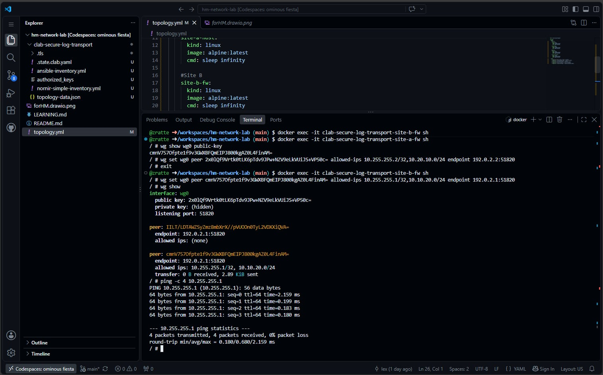
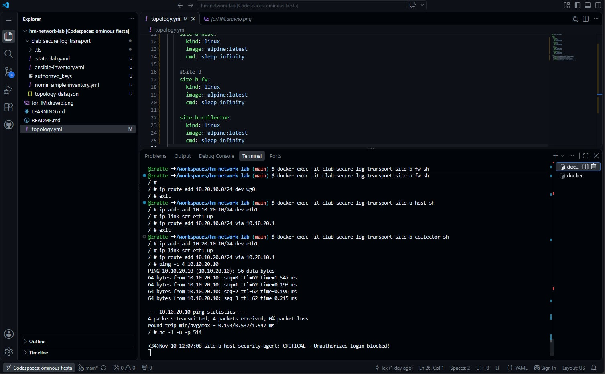

Day 1
Goal:    Get the lab environment set up without burning through my free quota.
Tried:   Spun up a 2-core GitHub Codespace and configured the idle timeout.
Broke:   Nothing actually broke today!
Learned: How to manage Codespace machine limits and timeouts to save compute hours (from AI / GitHub docs).
Next:    Figure out the IP schema and draw the topology diagram.

Day 2
Goal:    Establish the WireGuard VPN tunnel and route syslog traffic end-to-end.
Tried:   Configured WireGuard interfaces, generated keys, peered firewalls, and added static routes.
Broke:   Got 100% packet loss on ping tests because I accidentally mixed up the public keys when pasting them.
Learned: WireGuard is "stealthy" and silently drops packets on key mismatch instead of giving an error. Verified true keys using `wg show wg0 public-key` (from AI, GeminiPRO).
Next:    Add my screenshots to the repo, commit everything, and wrap up the project.

Day 3
Goal:  Polish, see if something needed a fix.
Tried:  Redoing the topology diagram.
Broke:  None so far
Learned:  Nothing new
Next:  Continue to see if there are things missing

